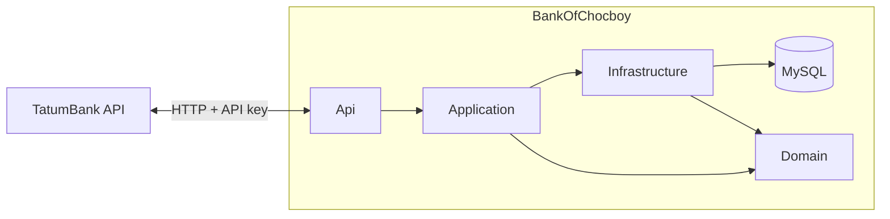

# BankOfChocboy

BankOfChocboy is a banking Web API built with .NET 10. It manages customer accounts and transactions, and it works as a partner bank to **TatumBank**: the two APIs talk to each other over HTTP to support transfers between banks, account lookups and airtime purchases.

The solution is split into class libraries so that each layer has one job and the business logic does not depend on the database or the web framework.

## Features

- Customer registration, login (JWT) and password hashing
- Account balance and transaction history
- Transfers, including transfers to and from TatumBank
- Airtime and data plan purchases
- Admin login, account freezing and an audit log of admin actions
- Inter-bank API protected by an API key
- Swagger UI for trying the endpoints

## Architecture

| Project | Responsibility |
|---|---|
| `BankOfChocboy.Api` | Controllers, authentication, filters, `Program.cs` |
| `BankOfChocboy.Application` | Business services, DTOs, and the interfaces the services depend on |
| `BankOfChocboy.Domain` | Models such as `Account`, `Transaction`, `Admin` and `Transfer` |
| `BankOfChocboy.Infrastructure` | Dapper repositories, database connection, HTTP client for TatumBank, password hashing, admin seeding |

Dependency rules:

- `Api` references `Application` and `Infrastructure`
- `Infrastructure` references `Application` and `Domain`
- `Application` references `Domain` only
- `Domain` references nothing

Services are registered with two extension methods, `AddApplication()` and `AddInfrastructure(configuration)`, called from `Program.cs`.



## Project structure

```
BankOfChocboy/
  BankOfChocboy.slnx
  src/
    BankOfChocboy.Api/
      Controllers/
      Filters/
      Program.cs
      appsettings.json
    BankOfChocboy.Application/
      DTOs/
      Interfaces/
      Services/
      Helpers/
    BankOfChocboy.Domain/
      Models/
    BankOfChocboy.Infrastructure/
      Repositories/
      HttpClients/
      Security/
      Seeding/
```

## Tech stack

- .NET 10, ASP.NET Core Web API
- MySQL with Dapper and MySqlConnector
- JWT bearer authentication
- Swagger (Swashbuckle)

## Getting started

### Prerequisites

- [.NET 10 SDK](https://dotnet.microsoft.com/download)
- MySQL 8 with an empty database for this app

### 1. Clone and build

```powershell
git clone <your-repository-url>
cd BankOfChocboy
dotnet build
```

### 2. Configure

Set your connection string, JWT settings and TatumBank settings in `src/BankOfChocboy.Api/appsettings.json` or, better, with user secrets so that no secrets are committed:

```powershell
dotnet user-secrets set "Admin:Username" "<admin username>" --project src\BankOfChocboy.Api
dotnet user-secrets set "Admin:Password" "<admin password>" --project src\BankOfChocboy.Api
dotnet user-secrets set "TatumBank:BaseUrl" "http://localhost:5086" --project src\BankOfChocboy.Api
dotnet user-secrets set "TatumBank:ApiKey" "<shared api key>" --project src\BankOfChocboy.Api
```

| Setting | Purpose |
|---|---|
| Database connection string | MySQL connection used by `DbConnectionFactory` |
| JWT `Issuer`, `Audience`, `Key` | Signing and validation of access tokens |
| `Admin:Username`, `Admin:Password`, `Admin:FullName` | First admin, created at startup if the `Admins` table is empty |
| `TatumBank:BaseUrl` | Address of the TatumBank API |
| `TatumBank:ApiKey` | Sent as the `X-Api-Key` header on calls to TatumBank |

### 3. Create the database tables

The API expects these tables: `Accounts`, `Transactions`, `Admins`, `AdminAuditLogs`, `IncomingTransfers` and `AirtimeVends`. Create them in your MySQL database before the first run.

### 4. Run

```powershell
dotnet run --project src\BankOfChocboy.Api
```

The API listens on `http://localhost:5087`. Open `http://localhost:5087/swagger` to try the endpoints.

## Communication with TatumBank

Both banks are separate APIs with their own databases. They share no tables and talk only over HTTP, sending the API key in the `X-Api-Key` header.

- TatumBank calls this API to look up an account (`GET /api/accounts/lookup/{accountNumber}`), to deliver a transfer (`POST /api/incoming-transfers`) and to request airtime.
- `InterbankApiKeyFilter` rejects interbank requests without a valid key.
- `IncomingTransfers.Reference` is unique, so a retried transfer cannot credit an account twice.
- This API calls TatumBank through `TatumBankClient`, registered in `AddInfrastructure`.

## Database

| Table | Contents |
|---|---|
| `Accounts` | Customer accounts, balances and the frozen flag |
| `Transactions` | Every debit and credit, with type, category and status |
| `IncomingTransfers` | Transfers received from other banks, one row per reference |
| `AirtimeVends` | Airtime requests received from other banks |
| `Admins` | Admin users |
| `AdminAuditLogs` | Record of admin actions |

## Author

Francis Egbuleze
